# Autonomous LEGO EV3 Mission Robot

**A team-built autonomous mobile robot for a timed, multi-task robotics challenge, developed with LEGO MINDSTORMS EV3 and LabVIEW.**

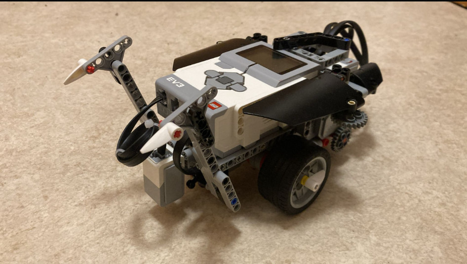

The project combined mechanical design, sensor-based navigation, and program-controlled actuation. A robot had to be placed in the designated starting area and then complete its assigned actions **without manual control after launch**. Our team designed, assembled, programmed, and tested a compact wheeled EV3 robot for this challenge.

**Outcome:** The team reached the **required passing score of at least 350 points**.

## Project at a glance

| Item | Description |
| --- | --- |
| Platform | LEGO MINDSTORMS EV3, using parts from the permitted NXT/EV3 construction kits |
| Programming | NI LabVIEW with LEGO NXT/EV3 integration |
| Navigation | Light-based line tracking and gyroscope-assisted turning |
| Manipulation | Motor-driven front fork / lifting mechanism and task-oriented attachments |
| Arena | Approximately 235 × 114 cm, enclosed by a 10 cm border |
| Run format | Up to three individual starts from the base area within a 3.5-minute course run |
| Scoring | 350 points required to pass; 700 maximum mission points |
| Project period | Winter semester 2023/24 |

## 1. The challenge

The field was a miniature city with a water-infrastructure theme. Each mission required the robot to travel to a specific location and physically interact with a LEGO mechanism, such as opening a valve, moving an object, triggering a lever, or operating a water-related installation.

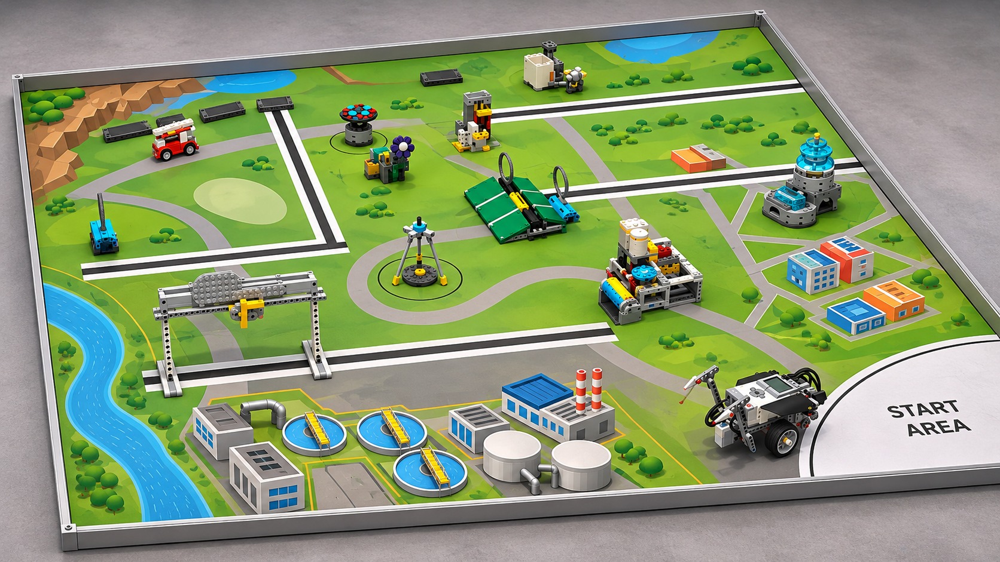

*AI-generated visualization of the challenge layout, showing the designated white quarter-circle start area. This is an illustrative rendering, not a dimensionally accurate reconstruction of the original field.*

### Rules and objectives

- **Autonomous operation:** The robot could only be positioned and started in the designated base area. After each start, the program had to carry out the actions independently.
- **Time limit:** A complete course run was limited to **3.5 minutes** and comprised three starts from the base area, with robots started individually and sequentially.
- **Hardware constraints:** Teams could combine parts from two permitted NXT construction kits; additional external construction parts were not allowed under the course rules.
- **Strategy:** The team could choose which missions to attempt. A passing result required **at least 350 out of 700 possible mission points**. The rules also allowed limited retries after a complete course run.

### Available missions

The official challenge presentation specified the following scoring opportunities. **This is the list of available tasks, not a claim that every task was successfully completed by our robot.**

| Mission | Points |
| --- | ---: |
| Open the water tap | 100 |
| Activate the toilet flush | 75 |
| Assemble a pipeline | 75 |
| Straighten / repair a pipeline | 100 |
| Water the flower | 50 |
| Move the fire truck to the fire | 50 |
| Extinguish the fire | 50 |
| Open two manhole covers | 25 each |
| Trigger rainfall | 50 |
| Activate the fountain | 50 |
| Operate the water-treatment installation | 50 |
| **Maximum mission score** | **700** |

**Examples of challenge mechanisms**

| Water-tap mechanism | Pipeline mechanism |
| --- | --- |
| 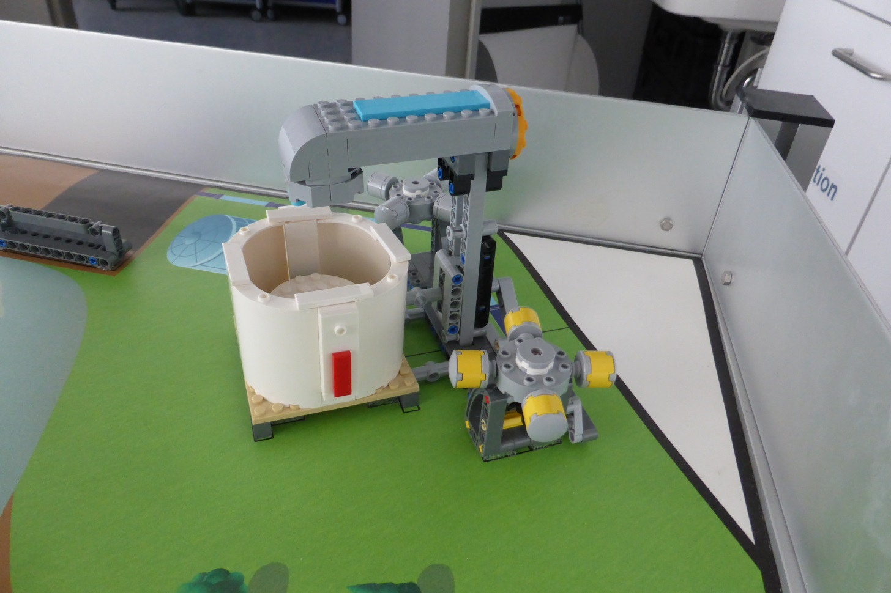 | 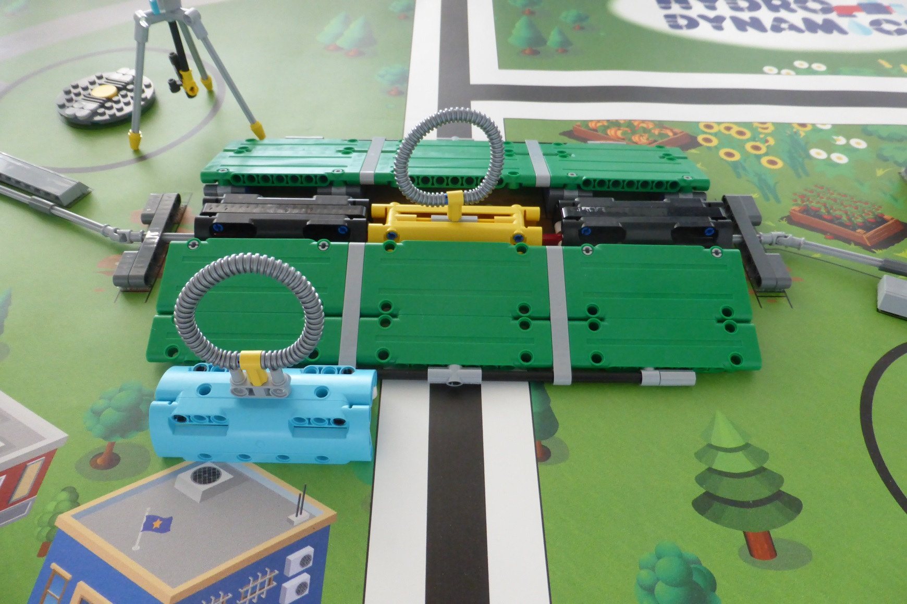 |
| Fire extinguishing mechanism | Rain-triggering mechanism |
| 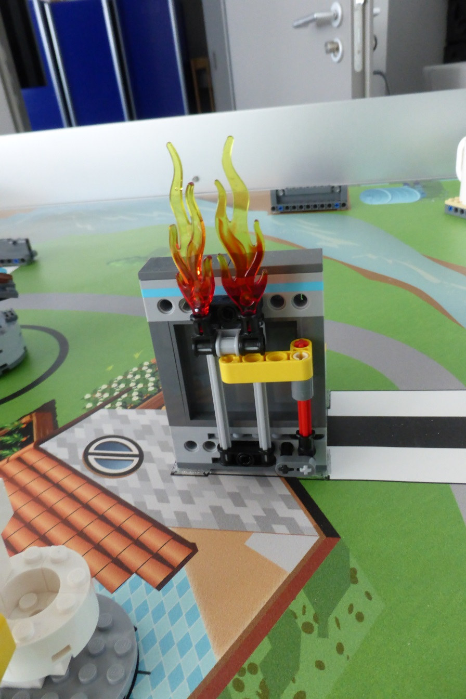 | 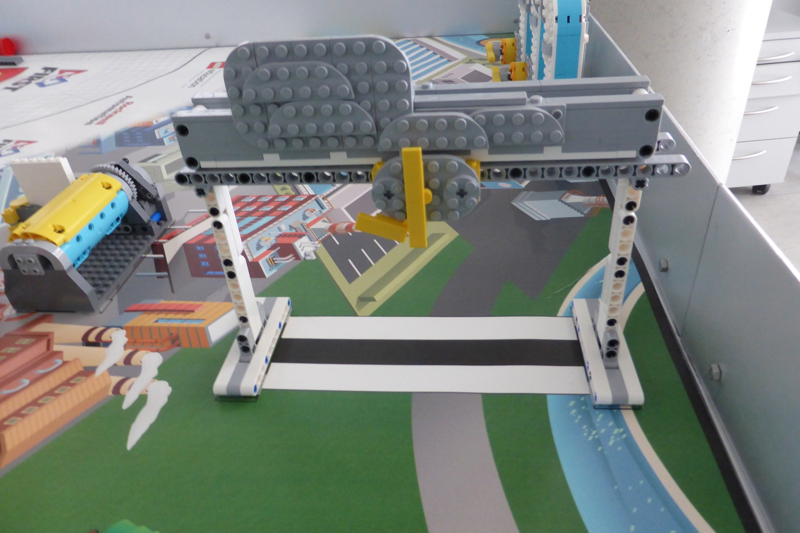 |

The variety of missions made the mechanical interface as important as the robot's navigation: the platform had to be compact enough to travel across the field while remaining capable of pushing, lifting, and actuating different objects.

## 2. Team organization and development process

The project was carried out as a group. We initially examined the challenge field, compared the available missions, and divided the work into **two subteams** to make progress in parallel. Mechanical development and programming were then integrated through regular joint work and testing sessions.

Our workflow followed an iterative engineering process:

1. **Analyze the field and rules** — identify scoring opportunities, navigation constraints, and required robot interactions.
2. **Assign responsibilities** — distribute design, assembly, programming, and mission planning across the team.
3. **Develop the robot** — build a low-profile wheeled chassis and mission-specific mechanical attachments.
4. **Implement control functions** — use LabVIEW to read sensors and control EV3 motors.
5. **Integrate and test** — combine mechanical and software modules, adjust turning and line-following behavior, and refine the mission sequence.
6. **Run the autonomous challenge** — start the robot from the base area and evaluate its performance against the scoring requirements.

## 3. Hardware design

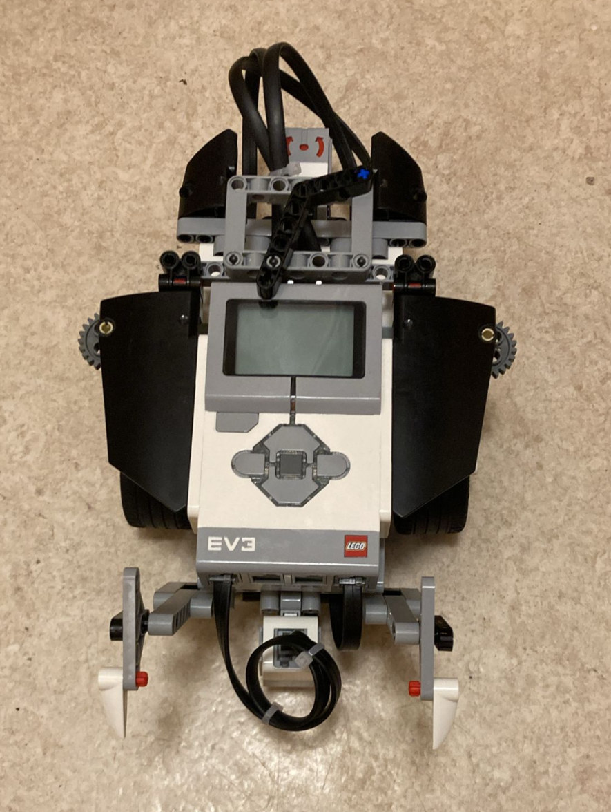

*Completed robot showing its compact layout, EV3 controller, wheels, and front-mounted mechanical assembly.*

### Main components

| Component | Position | Purpose |
| --- | --- | --- |
| EV3 programmable brick | Main chassis | Runs the LabVIEW control program and connects the motors and sensors |
| Two drive motors and wheels | Left and right drivetrain | Drive the robot and enable differential steering; motor ports **B** and **C** appear in the supplied LabVIEW VIs |
| Color sensor | Front center | Detects contrasting field markings for line-based navigation; the line-following VI uses a **light-intensity** reading |
| Gyroscope | Rear center | Provides the angular feedback used by the turning routine |
| Two touch sensors | Rear left and rear right | Provide contact detection |
| Servo motor and fork / lifting attachment | Front | Motor-driven manipulation of field elements during missions |
| Additional LEGO attachments | Chassis exterior | Support physical interaction with obstacles and task mechanisms |

### Mechanical design choices

- **Wheels rather than tracks** were selected for traction on the challenge surface.
- A **low, compact profile** helped the robot navigate the course and pass under a **10 cm-high gate**.
- The **front lifting / fork assembly** was designed for discrete actuation rather than delicate multi-axis manipulation.
- **Small freely rotating gears on the sides** helped the robot move alongside walls with less friction.
- A **roof-mounted mechanical lever** was included to actuate a gate mechanism while passing beneath it.
- Cables were secured to minimize interference with the moving mechanisms.

These observations are based on the supplied robot photographs and the team's hardware presentation. Exact gearing ratios, motor assignments for the fork, and mechanical dimensions were not documented.

## 4. Software and control logic

The robot was programmed in **LabVIEW for LEGO NXT/EV3**. The available source files contain two VIs, covering line following and gyro-based turning. The **original main VI is missing**.

### 4.1 Line following — `Line Follower.vi`

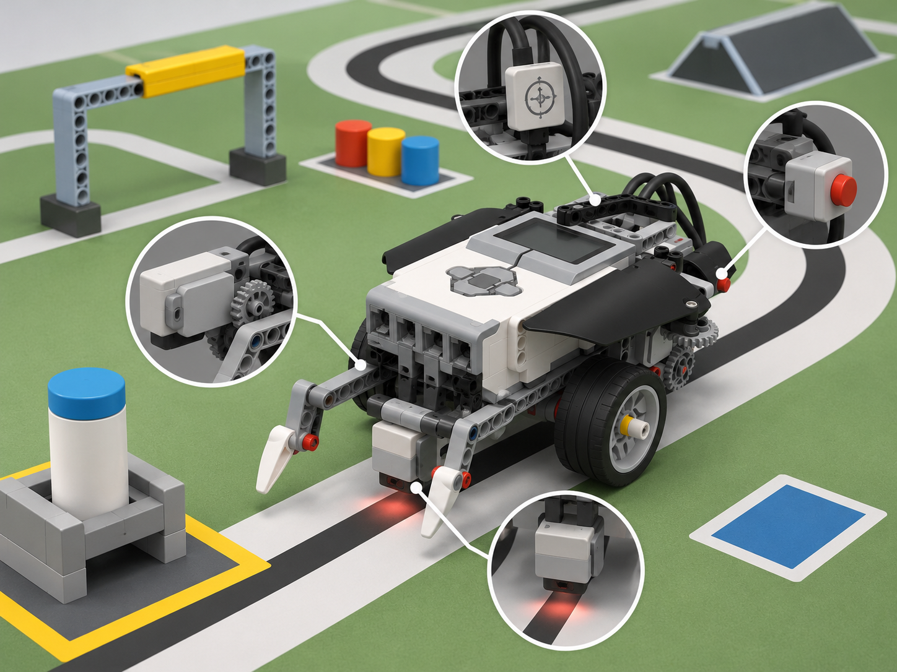

*AI-generated illustration of the front-mounted color sensor following a contrasting line. The red sensing effect is conceptual and does not represent a recorded sensor measurement.*

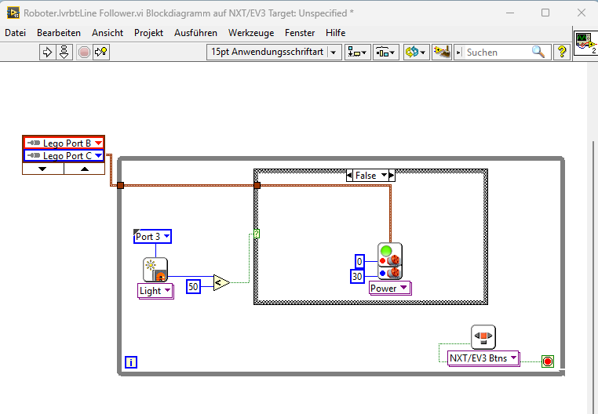

The diagram shows a simple feedback-based navigation loop:

1. The light sensor is read on **input port 3**.
2. The measured light intensity is compared against a **threshold value of 50**.
3. The resulting Boolean condition selects between two branches in a Case Structure.
4. Motor commands for drive ports **B** and **C** are issued depending on the detected surface brightness.
5. This process repeats inside a loop, allowing the robot to respond to dark and light field markings.

In the visible **False** branch, the motor-control block has numeric inputs of **0** and **30**. The screenshot does not establish that these are separate left- and right-wheel power values. The other branch is not shown, so its exact motor settings are not described here. The diagram also contains a brick-button read connected to the loop termination logic.

**Interpretation:** The routine uses threshold-based, reactive line tracking, rather than a proportional or PID controller in the documented view.

### 4.2 Gyroscope-assisted turning — `SubVI Drehung.vi`

The turning VI uses an adjustable **target angle** (*Wunschwinkel*) and reads the **gyro angle from input port 4**. The supplied screenshots show two branches of the direction-dependent turning logic.

| Case = True | Case = False |
| --- | --- |
| 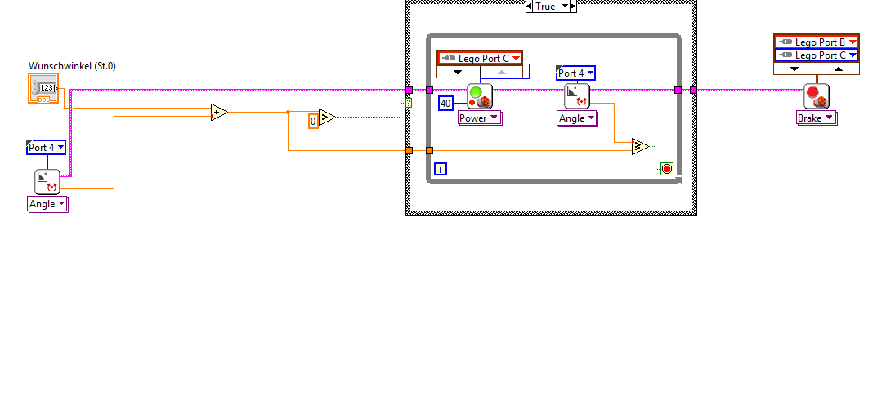 | 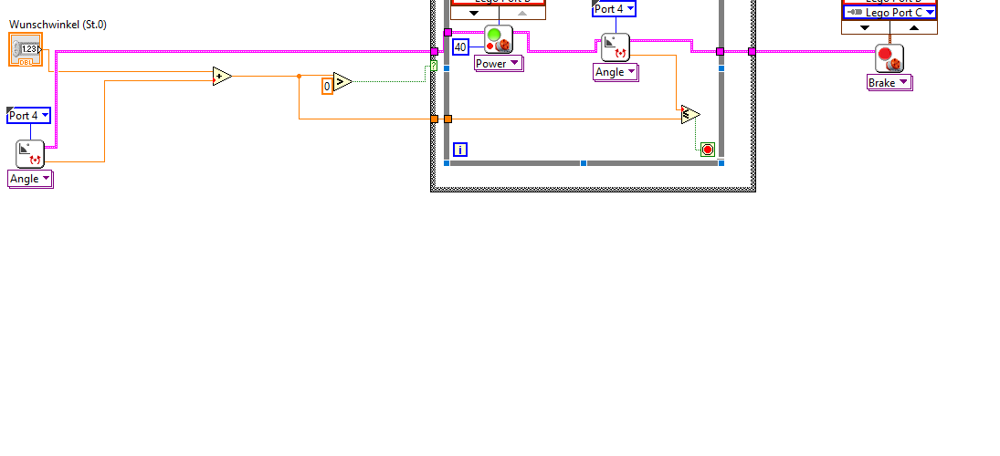 |

The visible control structure:

1. Takes an angle setpoint and a measured gyro angle.
2. Uses a sign-dependent comparison to select a turning branch.
3. Drives an EV3 motor at a displayed power setting of **40**; the two branches use different motor ports (**C** or **B**).
4. Repeatedly checks the gyro angle against a comparison condition to determine when the turn should end.
5. Applies a **brake command to both drive motors** when the routine finishes.

This is evidence of **sensor-feedback-assisted turning**. The precise global heading convention, calibration procedure, and how the main program sequenced turns are not available.

### 4.3 Partial sequence documentation

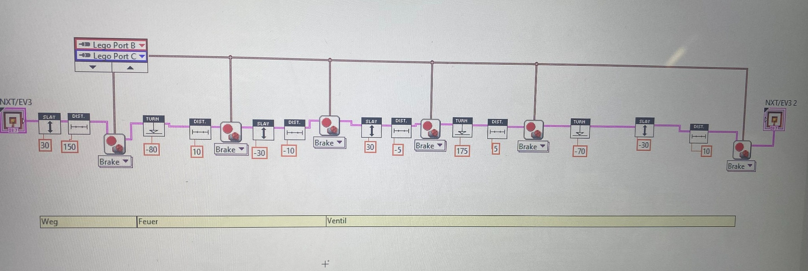

*This image shows a short sequence of linked tasks within the course. The individual steps are documented below in Markdown to outline the basic workflow.*

### Software files

```text
software/
└── labview/
    ├── Line Follower.vi
    ├── SubVI Drehung.vi
    └── project/
        └── Roboter.lvrbt
```

The `.vi` files are original LabVIEW virtual instruments, and `Roboter.lvrbt` is the supplied LabVIEW robot library descriptor. The library references `Line Follower.vi` using a relative path; this folder layout preserves that relative reference. It does **not** contain the missing top-level control program.

The VIs may require a compatible LabVIEW version and the corresponding LEGO NXT/EV3 support components. They are provided as project artifacts, **not as a complete, directly deployable application**.

## 5. Outcome and lessons learned

**The team achieved the required course points and met the project's passing criterion.** The project demonstrated the integration of mechanical design, LEGO hardware, and LabVIEW control in a constrained autonomous robotics task.

Key engineering takeaways included:

- **Mechanics and software must be designed together.** Reliable mission interactions depend on the robot's geometry and actuation as much as its path planning.
- **Simple sensor feedback is practical.** Threshold-based navigation and measured-angle turning are straightforward building blocks for autonomous field robots.
- **Physical constraints influence the entire architecture.** Clearance, traction, side-wall interaction, and cable routing affected the mechanical design.
- **Integration testing is essential.** Navigation and manipulation routines must operate reliably together under a fixed course time limit.


## Repository structure

```text
.
├── README.md
├── assets/
│   └── images/
│       ├── robot-overview.jpg
│       ├── robot-top-view.jpg
│       ├── challenge-course.jpg
│       ├── challenge-course-synthetic.png
│       ├── color-sensor-line-following.png
│       ├── mission-water-tap.jpg
│       ├── mission-pipe-repair.jpg
│       ├── mission-fire.jpg
│       ├── mission-rain-trigger.jpg
│       ├── labview-line-follower.png
│       ├── labview-turn-case-true.png
│       ├── labview-turn-case-false.png
│       └── labview-sequence-screenshot.jpg
└── software/
    └── labview/
        ├── Line Follower.vi
        ├── SubVI Drehung.vi
        └── project/
            └── Roboter.lvrbt
```

---

*Team project, winter semester 2023/24. Mission descriptions and mission photographs were taken from the supplied course presentation; the robot photographs and LabVIEW screenshots document our team's prototype. The two images identified as AI-generated are conceptual illustrations, not photographs or exact reproductions of the course.*
